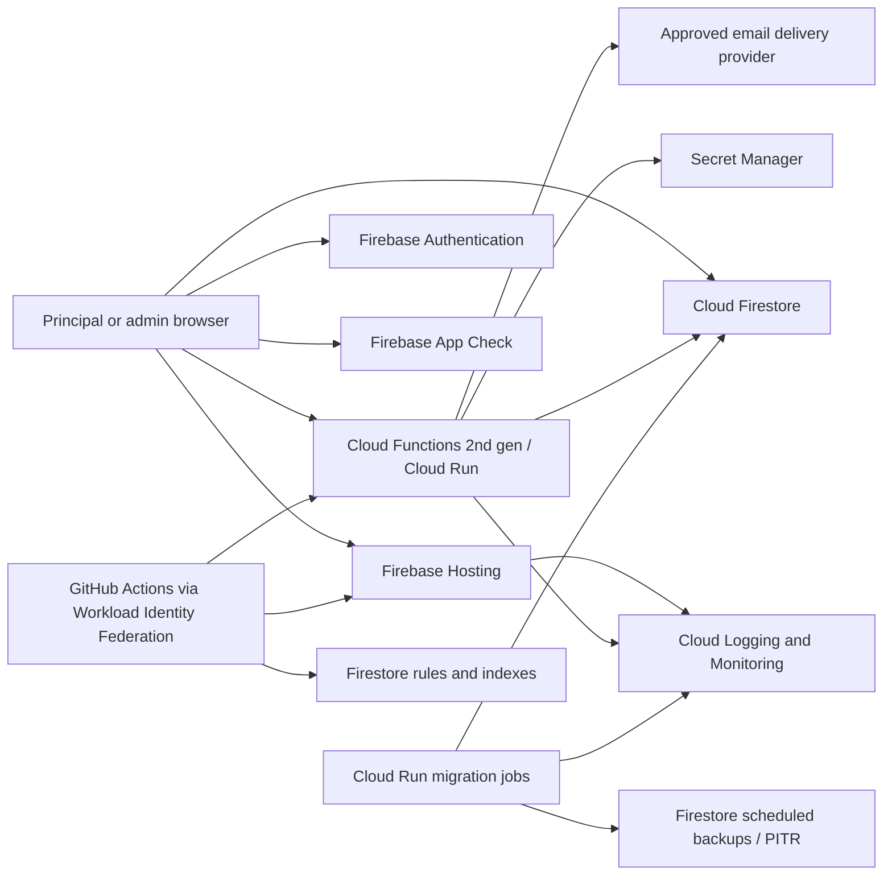

# Infrastructure and Operations Requirements

Status: Approved development baseline; production details remain gated
Last updated: 2026-08-02

## Scope and authority

This document defines the infrastructure, deployment, data-change,
observability, recovery, and platform-security baseline for the Small Moves PEF
Portal.

The following constraints are approved:

- `otherones/small-moves` is the sole implementation and documentation target.
- Legacy Principal Emergency Fund repositories are out of scope and will be
  deprecated. They are not deployment targets or authoritative sources.
- The application is hosted on Google Cloud Platform (GCP).
- Firebase provides application hosting, operational data storage, and user
  authentication.

Recommendations below are the default implementation approach. Deviations
require a documented decision or architecture decision record (ADR), including
security, operational, cost, and migration consequences.

## 1. Platform requirements

| ID | Requirement | Verification |
|---|---|---|
| INF-001 | All production workloads and data must run in GCP projects owned by Small Moves. | Resource inventory contains no production dependency in another cloud or legacy project. |
| INF-002 | The React/Vite single-page application must use Firebase Hosting as the initial web-hosting target. | A tagged build is served over HTTPS from the approved production Firebase Hosting site. |
| INF-003 | Cloud Firestore must be the primary operational application database. | Production application reads and writes use the approved production Firestore database. |
| INF-004 | Firebase Authentication must provide end-user authentication. Upgrading to Firebase Authentication with Identity Platform is required before TOTP multi-factor authentication is enabled. | Authentication configuration and end-to-end tests cover approved sign-in, enrollment, recovery, and session flows. |
| INF-005 | Trusted server-side behavior must run in Cloud Functions for Firebase (2nd gen) or Cloud Run. Browser code must not hold privileged credentials or perform privileged state transitions. | Architecture and authorization tests show privileged operations are server-owned. |
| INF-006 | Cloud Run Jobs must be the default runner for production Firestore data migrations and other bounded administrative jobs. | A migration can execute with a dedicated identity, retry policy, timeout, structured logs, and recorded result. |
| INF-007 | Cloud Logging and Cloud Monitoring must be the operational telemetry systems of record. | Production logs, dashboards, and actionable alerts are accessible to the approved operators. |
| INF-008 | Secrets used by trusted workloads must be stored in Secret Manager. | No production secret is committed, embedded in a client bundle, or stored in a GitHub Actions secret when workload identity can be used instead. |

Firebase App Hosting is not the initial target because the current product is a
React/Vite SPA. Adopting server-side rendering or a supported full-stack
framework may justify App Hosting later, but that change requires an ADR.

## 2. Target service topology

App Check reduces abuse of Firebase resources but is not authentication or
user authorization. Firestore Security Rules protect client SDK access;
server SDKs bypass those rules and therefore require both least-privilege IAM
and explicit server-side authorization.

## 2.1 Approved development deployment baseline

| Item | Approved development value |
|---|---|
| GCP/Firebase project | `small-moves-portal` (project number `423624575686`) |
| Billing | Attached |
| Regional services | `us-west2` |
| Web hosting | Firebase Hosting |
| End-user authentication | Firebase Authentication |
| Initial URL | Temporary Firebase Hosting URL; custom domain deferred |
| Initial administrator/deployer | The designated Google account in project IAM |
| Data | Synthetic development data only |
| Production | Separate GCP/Firebase project to be provisioned before launch |

This baseline authorizes development-environment click-ops and implementation. It does not authorize production provisioning, live data, or production deployment. Production decisions are tracked in DEC-022.

## 3. Environment isolation

Use a separate GCP/Firebase project for development and a separate project for production. Staging is recommended before production launch and must be isolated if used. Environments must not share Firestore databases, Authentication users, secrets, storage buckets, service accounts, or third-party credentials.

| Environment | Purpose | Data policy | Deployment policy |
|---|---|---|---|
| Development | Initial click-ops, emulator use, and integration work in `small-moves-portal` | Synthetic data only | Designated administrator/developer may deploy manually to Firebase Hosting |
| Staging | Release-candidate, integration, security, and smoke testing | Synthetic or explicitly approved de-identified fixtures | Automatic deployment from the protected release path is recommended |
| Production | Live portal | Approved live data only | Protected GitHub environment, least-privilege deploy identity, and explicit approval |

Additional requirements:

- Project IDs, region, Firestore database location, Hosting site names, domains,
  and billing accounts must be recorded before scaffolding production resources.
- Local development and CI must use the Firebase Local Emulator Suite wherever
  practical for Auth, Firestore, Functions, Hosting, and Security Rules tests.
- Preview URLs must deploy against a nonproduction Firebase project. Firebase
  Hosting preview channels normally continue to use real backend resources, so
  a production project must never be used for an untrusted pull-request preview.
- Production configuration must fail closed when an environment identifier is
  missing or invalid.
- Billing budgets and alerts must exist for every billable project. A budget
  alert is not a hard spending cap, so abuse and usage controls remain required.

## 4. Low-friction deployment

### 4.1 Recommended delivery path

1. A pull request runs formatting, linting, type checking, unit tests, Security
   Rules tests in the emulator, integration tests, dependency scanning, and a
   production build.
2. For trusted branches, CI publishes the built SPA to a Firebase Hosting
   preview channel in a nonproduction project and records the preview URL on the
   pull request. Pull requests from forks must not receive deploy credentials.
3. A merge to the protected default branch deploys the same immutable commit to
   staging, applies compatible rules and indexes, and runs smoke tests.
4. Production deployment uses a protected GitHub environment and the approved
   promotion rule. The deployed version, commit SHA, actor, timestamp, and
   result are recorded.
5. Failed verification stops promotion. The operator can roll back Hosting and
   trusted compute independently to a known-good release.

### 4.2 Deployment controls

- GitHub Actions must authenticate to GCP with Workload Identity Federation
  using short-lived credentials. Do not create a long-lived service-account JSON
  key for deployment.
- Use separate, narrowly scoped deployment service accounts per environment.
- Keep Firebase configuration, Hosting headers/redirects, Firestore Security
  Rules, Firestore indexes, function/run definitions, and monitoring policy
  definitions under version control.
- Deployment scripts must be noninteractive, repeatable, and environment
  explicit. A production deploy must reject a nonproduction target and vice
  versa.
- Build once and promote the same commit and artifact. Do not rebuild production
  from a different dependency resolution.
- Database migration is a separately approved step. Application deployment must
  not silently launch a destructive migration.
- Rollback instructions and a smoke-test checklist must exist before the first
  production release.

The exact production promotion policy—automatic after staging, manual approval,
or release tag—remains an operational decision. The default for the first
release is manual approval after staging smoke tests.

## 5. Firestore schema evolution and data migrations

Firestore is schemaless, but application code still depends on document shapes,
required fields, indexes, rules, and invariants. Every material data-shape
change must have a compatibility and migration plan.

### 5.1 Migration package

Each migration must be versioned in the repository and include:

- an immutable migration ID and description;
- the owning feature and compatible application versions;
- preconditions and estimated document count/cost;
- a dry-run or read-only validation mode;
- idempotent, bounded, and resumable execution;
- batch size, concurrency, retry, timeout, and rate-limit settings;
- a stored cursor/checkpoint for large collections;
- before/after validation queries or invariants;
- sensitive-data and logging review;
- backup/PITR requirements and a forward recovery plan;
- operator instructions and an explicit production approval step.

A protected migration ledger, such as `__system/migrations`, must record the
migration ID, checksum, application commit, environment, start/end time, status,
checkpoint, counts, and sanitized failure summary. Rerunning a completed
migration with a different checksum must fail.

### 5.2 Expand, migrate, contract

Use this sequence for incompatible changes:

1. **Expand:** deploy code and rules that tolerate both old and new document
   shapes; add new fields/indexes without removing old readers.
2. **Migrate:** run the Cloud Run Job in nonproduction, validate it, create the
   required production recovery point, run the approved production job, and
   verify counts and invariants.
3. **Contract:** after all active code reads the new shape and rollback risk has
   passed, remove compatibility code and obsolete fields in a later release.

Destructive down migrations are not the default. Prefer a compensating forward
migration from a verified backup or point-in-time recovery source.

### 5.3 Rules and indexes

- Store Firestore Security Rules and `firestore.indexes.json` in the repository.
- Test Rules against representative allowed and denied cases with the emulator.
- Deploy additive indexes before application code depends on them.
- Treat console-created indexes as drift: copy approved changes into the
  versioned index file immediately.
- Security Rules changes use the same review and promotion path as application
  code; they must not be manually edited in production as a normal workflow.
- Migration jobs use a dedicated service account with only the permissions
  required for the target collections and supporting services.

## 6. Backups, continuity, and recovery

This is a business-hours recovery posture for a small application. It favors
tested, managed recovery mechanisms over active-active infrastructure or a
separate hot standby.

### 6.1 Recovery objectives

| Objective | Approved target | Interpretation |
|---|---|---|
| Recovery point objective (RPO) | No more than 24 hours of committed production data | Daily scheduled backups provide the conservative guarantee. PITR normally permits a finer, minute-level recovery point for incidents detected within its seven-day window. |
| Recovery time objective (RTO) | Restore core portal service within one business day after an authorized recovery decision | This is an internal operating target, not a contractual SLA or an after-hours response guarantee. |
| Recovery coverage | Firestore production data, required configuration, indexes/rules, deployed application version, and secrets/configuration references | Third-party service restoration follows the provider's service and is documented in the runbook. |

No active-active deployment, hot standby, cross-region duplicate application, or
24/7 continuity team is required for the initial release. Revisit that posture
only if usage, funding, or business impact materially changes.

### 6.2 Backup policy

- Enable Firestore point-in-time recovery (PITR) for the production database
  before live data is accepted. PITR provides a rolling seven-day history and
  minute-level recovery-point selection outside the most recent hour.
- Schedule one native Firestore backup every day and retain each backup for 35
  days. This requires a billing-enabled production project.
- Create an on-demand backup or confirm a usable PITR recovery point immediately
  before a destructive or high-risk production migration.
- Restrict backup administration and restore permissions to the recovery
  operator role. Backup configuration changes are audited.
- Alert on a missed or failed scheduled backup as a Severity 2 operational
  incident.

### 6.3 Restore procedure and testing

- Restore or clone into a new recovery database rather than overwriting the
  production database with an unverified result.
- Validate document counts, request/budget invariants, required indexes, Security
  Rules, application compatibility, and a representative set of user journeys
  before controlled cutover or approved re-import.
- Run the approved retention cleanup after a restore before general access is
  reopened, because a backup may temporarily reintroduce data whose live copy
  had already expired.
- Name one recovery owner and one backup operator. Response follows the
  business-hours escalation model in §7.
- Complete and record a restore exercise before launch, annually thereafter,
  and after a material change to the data architecture or recovery procedure.

## 7. Logging, monitoring, and auditability

### 7.1 Structured logging

Trusted services and jobs must emit structured logs with, where applicable:

- severity, event name, service, environment, release/commit SHA;
- trace or correlation ID and a domain request ID;
- outcome, error category, duration, retry count, and dependency name;
- migration ID, checkpoint, processed/changed/failed counts for migrations.

Do not log passwords, authentication tokens, TOTP secrets, invitation tokens,
bank/payment credentials, full beneficiary or student details, raw request
bodies, rendered email bodies, or unrestricted document snapshots. Prefer
stable internal identifiers; use approved redaction or keyed pseudonyms when
correlation is necessary.

### 7.2 Service objective and operational signals

Core portal availability has a 99.5% monthly internal objective. It is an
operational health target, not a contractual SLA, and it does not establish a
24/7 support commitment. Monitor availability and error rates for Hosting and
trusted APIs; monitor latency until a production baseline supports useful
thresholds.

At minimum, production dashboards and alerts must cover:

- Hosting and trusted-API availability and error rate;
- authentication failure spikes and account-recovery failures;
- function, Cloud Run service, scheduled cleanup, and migration-job failures;
- transition-email delivery failures and stale manual payout work;
- Firestore quota/usage anomalies, denied requests, and index errors;
- scheduled-backup and PITR configuration health; and
- billing anomalies and budget thresholds.

### 7.3 Alert ownership and response

Name one primary staff owner and one backup. Route alerts to a shared,
organization-controlled mailbox or group rather than a personal address.

| Severity | Examples | Notification and acknowledgement target |
|---|---|---|
| Severity 1 | Broad outage, suspected unauthorized access, suspected material data loss, or widespread authentication failure | Notify primary and backup immediately. Acknowledge within two business hours. After-hours response is best effort and is not guaranteed. |
| Severity 2 | Material feature degradation, failed backup/migration/cleanup job, sustained email-delivery failure, or budget/invariant anomaly | Notify the shared route; acknowledge by the next business day. |
| Severity 3 | Cost/usage warning, isolated retry, or nonurgent operational defect | Add to weekly operational triage. |

Every actionable alert must identify its owner, severity, notification route,
runbook, test method, and the signal that clears it. Review dashboards and alert
noise monthly; exercise one representative Severity 1 route and the backup
operator path at least quarterly. A dedicated NOC, formal 24/7 on-call rotation,
SIEM, and error-budget program are not required initially.

### 7.4 Log and audit retention

| Record | Approved retention and location |
|---|---|
| Application/runtime logs and selectively enabled Data Access audit logs | 30 days in the project's `_Default` Cloud Logging bucket |
| Required Cloud Audit Logs | Google-managed `_Required` bucket and its 400-day retention |
| Product-domain audit events | Durable application records governed by §8.4, not by Cloud Logging retention |

Cloud Audit Logs record access and administrative activity for GCP resources.
Do not blanket-enable all Firestore end-user Data Read logs. Before launch,
enable the approved Data Access categories for privileged administrative and
secret-access activity after a staging volume/cost review; add broader categories
only when a documented security need justifies the volume and sensitive-data
exposure.

Product-domain audit events—request transitions, budget entries, MOU actions,
role changes, settings changes, payout actions, retention actions, and recovery
actions—must be append-only application records. Infrastructure logs are not a
substitute. Access to logs and audit data follows least privilege and is itself
auditable.

## 8. Security baseline

### 8.1 Identity and authorization

- Deny access by default in Firestore Security Rules, routes, and trusted APIs.
- Bind authorization to the verified Firebase user ID plus approved role and
  school-membership records. Hidden controls are not authorization.
- Use custom claims only for small, coarse access-control facts, such as a
  platform-admin marker. Store mutable profile and school membership data in
  Firestore; do not treat custom claims as a general profile store.
- Trusted endpoints must verify Firebase ID tokens and re-check current
  authorization for sensitive actions.
- Firebase Authentication with Identity Platform owns email verification,
  password reset, sessions, recent reauthentication, session revocation, and
  TOTP enrollment/challenge/unenrollment. The portal stores no associated
  credential, action code, session token, MFA resolver, TOTP secret, or backup
  code.
- The portal frontend must initiate, render, and complete the supported Firebase
  journeys: verification send/resend/action, sign-in and TOTP challenge,
  password-reset request/action, recent reauthentication, password/email
  update, session-expiry recovery, factor enrollment/unenrollment/re-enrollment,
  and lost-authenticator support handoff. These are client orchestration and UX
  requirements, not a custom credential backend.
- The Firebase email-action handler must validate and apply
  `resetPassword`, `verifyEmail`, and `recoverEmail` action codes through
  the Web SDK, avoid persisting/logging the codes, and allow only approved
  same-origin continuations.
- The portal exposes no custom administrator password reset, MFA bypass, or TOTP
  reset. A user who cannot access an enrolled factor receives a support path;
  operators may use audited Firebase platform capabilities outside the portal
  under least privilege, after which the frontend supports sign-in and required
  re-enrollment.
- Invitation acceptance binds a verified Firebase UID to a pending school
  membership. Authorization follows DEC-002: Additional Contacts are limited to
  their own submitted requests; Principals retain school-wide authority; only an
  authorized system administrator assigns or elevates roles.
- Require TOTP/recent authentication for privileged admin and settings actions.

### 8.2 Data and service protection

- Classify each field before production use and minimize collection of student,
  beneficiary, contact, and payout data.
- Do not store raw bank or card credentials in Firestore. The portal has no
  payment-provider integration and does not execute payments. Authorized admins
  validate, confirm, and execute payout outside the portal, then record the
  approved request transition and minimum non-sensitive evidence.
- Use Secret Manager for server secrets and rotate them under a documented
  process. Client Firebase configuration is public configuration, not a secret.
- Enforce HTTPS and define Firebase Hosting security headers, including a tested
  Content Security Policy, clickjacking protection, MIME sniffing protection,
  referrer policy, and an appropriate permissions policy.
- Enable Firebase App Check with reCAPTCHA Enterprise for supported web access.
  Observe valid traffic first, then enforce per service. App Check supplements,
  but does not replace, authentication, authorization, validation, or rate
  limiting.
- Validate and normalize all trusted API input. Rate-limit abuse-sensitive
  actions such as invitations, email test-send, template publication,
  authentication recovery, settings changes, and repeated transition attempts.
- Use separate service accounts for application runtime, migration, backup, and
  deployment duties. Grant the minimum resource-level permissions and review
  access regularly.

### 8.3 Delivery and verification

- Protect the default branch and production GitHub environment with review and
  required checks.
- Pin or otherwise control third-party CI actions, scan dependencies and built
  artifacts, and remediate critical vulnerabilities before production.
- Test positive and negative Security Rules cases, role/school isolation, token
  revocation, App Check enforcement, and privileged server authorization in CI
  and preproduction.
- Maintain a lightweight threat model covering authentication, cross-school data
  access, invitations, request-scoped beneficiary data, manual payout evidence,
  settings/template abuse, repeated transitions, migration identities, logs,
  backups, and administrator abuse.
- Maintain an incident runbook with access revocation, secret rotation, release
  rollback, evidence preservation, notification ownership, and recovery steps.

### 8.4 Data retention and deletion

This is an internal data-governance policy for a small charity, not an assertion
that an external regulatory retention period applies. Minimize collected data
and do not retain application records indefinitely.

| Data class | Approved lifecycle |
|---|---|
| Core program, financial, and domain-audit history | Retain requests' non-sensitive facts, status transitions, budget ledger entries, principal-year MOU signatures, configuration versions, payout action evidence, and administrator actions for seven years after the end of the related school year. |
| Request-scoped sensitive details | Retain beneficiary, student, payee, contact destination, and payout-instruction details for three years after the request becomes terminal; then redact or anonymize those fields while preserving the minimum non-identifying request, amount, category, status, ledger, and audit history required by the seven-year rule. |
| User profiles and memberships | Retain while the relationship is active and for two years after it ends; then delete or pseudonymize profile fields. Historical events retain an opaque actor reference rather than a copied name/email. |
| Application invitation and action tokens | Delete no later than 30 days after expiration. Never store Firebase credentials, password-reset secrets, session tokens, or TOTP secrets in application data. |
| Email delivery evidence | Retain recipient identifier, template version, event, outcome, and timestamps for two years. Do not store rendered email bodies by default; template configuration versions follow the seven-year core-history rule. |
| Operational and platform logs | Follow §7.4: 30 days for application/Data Access logs and the platform-controlled 400 days for required audit logs. |
| Recovery copies | PITR retains seven days; scheduled backups retain 35 days. Data deleted from the live database may remain only until those recovery copies expire. |

A scheduled, idempotent retention job must run at least weekly. It supports a
dry run, records counts by data class without logging personal data, emits an
append-only retention event, and alerts on failure. Review the policy and a
sample cleanup result annually.

A named owner may place a documented legal or investigation hold on a specified
request, school, identity, or date range. The hold records the reason, approver,
scope, start date, and review date and suspends affected deletion/redaction
until explicitly released. A separate legal-hold UI is not required initially;
an audited operator procedure is sufficient.

Account-deletion processing must disable/delete the Firebase Authentication
identity, end active memberships, and delete or pseudonymize profile data
according to this schedule. It must preserve required financial and domain-audit
history using opaque actor references. A restore runbook must prevent expired
personal data from becoming generally accessible again.

## 9. Required repository artifacts

Before production implementation is considered ready, the repository must
contain or intentionally link to:

- environment and regional configuration;
- Firebase project aliases and Hosting configuration;
- Firestore Rules, index definitions, and emulator tests;
- repeatable CI workflows using Workload Identity Federation;
- migration source, migration ledger contract, and operator runbook;
- monitoring dashboards/alerts and log-field/redaction conventions;
- backup schedules, retention policy, and tested restore runbook;
- security threat model, role/permission matrix, and data classification;
- versioned retention schedule, weekly cleanup job/runbook, hold procedure, and
  account-deletion procedure;
- release, smoke-test, rollback, incident, and access-review procedures.

## 10. Decisions still required

DEC-018 through DEC-021 are resolved for the development baseline. Before production launch, resolve DEC-022 with the separate production project, billing owner, domain, production Firestore location, promotion rule, and emergency-deployment authority.

The approved application role/membership model is recorded in DEC-002 and must be implemented in Security Rules and trusted APIs. See the [decision log](../planning/decision-log.md).

## Official platform references

- [Firebase Hosting overview](https://firebase.google.com/docs/hosting)
- [Firebase Hosting preview channels](https://firebase.google.com/docs/hosting/test-preview-deploy)
- [Firebase Hosting GitHub integration](https://firebase.google.com/docs/hosting/github-integration)
- [Firebase Security Rules](https://firebase.google.com/docs/rules)
- [Firestore rules and queries](https://firebase.google.com/docs/firestore/security/rules-query)
- [Firestore index management](https://firebase.google.com/docs/firestore/query-data/indexing)
- [Firestore managed export and import](https://firebase.google.com/docs/firestore/manage-data/export-import)
- [Firestore point-in-time recovery](https://firebase.google.com/docs/firestore/use-pitr)
- [Firestore scheduled backups](https://firebase.google.com/docs/firestore/backups)
- [Firestore disaster recovery](https://firebase.google.com/docs/firestore/disaster-recovery)
- [Cloud Run Jobs](https://cloud.google.com/run/docs/create-jobs)
- [Cloud Functions for Firebase version comparison](https://firebase.google.com/docs/functions/version-comparison)
- [Secret Manager overview](https://cloud.google.com/secret-manager/docs/overview)
- [Cloud Billing budgets and alerts](https://cloud.google.com/billing/docs/how-to/budgets)
- [Firebase structured function logging](https://firebase.google.com/docs/functions/writing-and-viewing-logs)
- [Cloud Logging log-based alerts](https://cloud.google.com/logging/docs/alerting/log-based-alerts)
- [Cloud Logging retention and quotas](https://cloud.google.com/logging/quotas)
- [Cloud Audit Logs](https://cloud.google.com/logging/docs/audit)
- [Configure Data Access audit logs](https://cloud.google.com/logging/docs/audit/configure-data-access)
- [Firebase custom claims](https://firebase.google.com/docs/auth/admin/custom-claims)
- [Firebase web user management and password reset](https://firebase.google.com/docs/auth/web/manage-users)
- [Firebase custom email action handlers](https://firebase.google.com/docs/auth/custom-email-handler)
- [Firebase email action continuation state](https://firebase.google.com/docs/auth/web/passing-state-in-email-actions)
- [Firebase session management](https://firebase.google.com/docs/auth/admin/manage-sessions)
- [Firebase TOTP multi-factor authentication](https://firebase.google.com/docs/auth/web/totp-mfa)
- [Firebase App Check for web](https://firebase.google.com/docs/app-check/web/recaptcha-provider)
- [Workload Identity Federation for deployment pipelines](https://cloud.google.com/iam/docs/workload-identity-federation-with-deployment-pipelines)
- [WCAG 2.2](https://www.w3.org/TR/WCAG22/)
