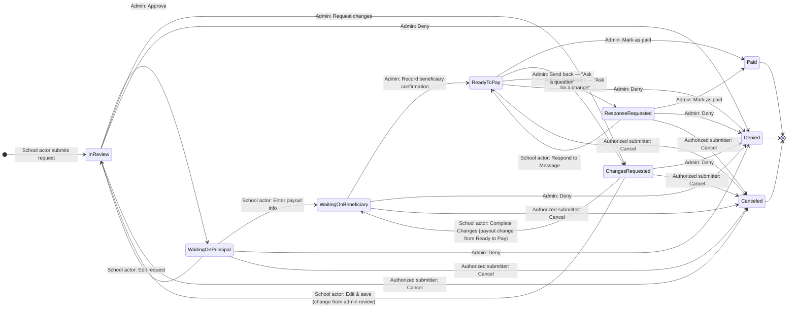
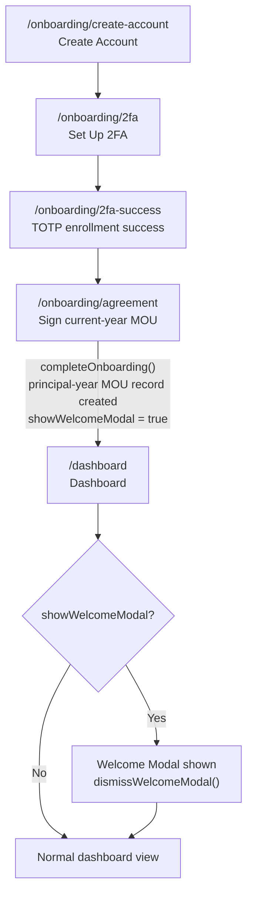
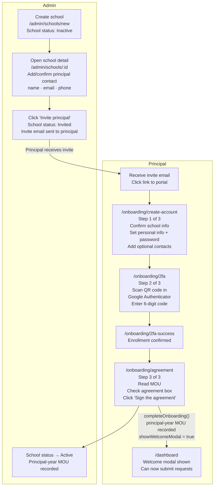
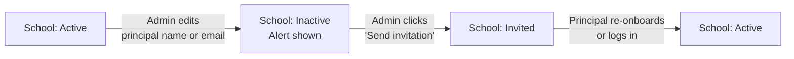
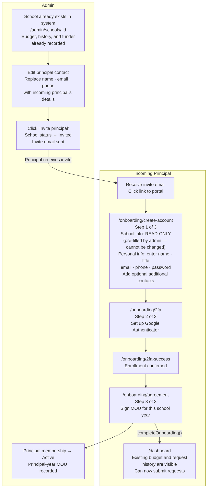
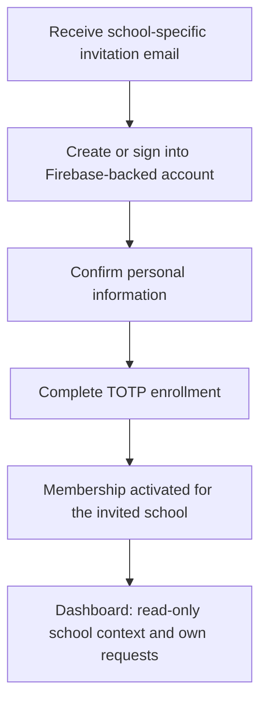
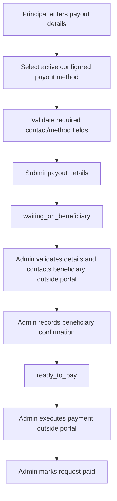

# PEF Portal — State Flow Diagrams
**Small Moves · Principal Emergency Fund**

---

## 1. Request Status State Machine

This is the core lifecycle of every emergency fund request.

> **Approved production model (2026-07-28):** Persist immutable status system
> names, not display copy. Admin and principal labels are configuration. The
> transition table in §2 controls actors, guards, task context, terminal
> behavior, audit events, budget effects, and notification events. `Canceled`
> and `Denied` are distinct terminal states; legacy prototype behavior that
> combines them is incorrect.



> **Production requirement:** `processing` and “Flag for investigation” are not part of the approved state machine. Ready-to-Pay send-back transitions use `changes_requested` or `response_requested` as defined in §2 and §3b.

---

## 1a. Canonical Status Vocabulary

System names are immutable API/database identifiers. Authorized admins may edit
the admin and principal display labels in `/admin/settings`; edits are audited
and apply prospectively wherever a status label is rendered. Label edits do
not alter transitions, permissions, template mappings, analytics identity, or
terminal behavior.

| System name | Initial admin label | Initial principal label | Terminal? |
|---|---|---|---|
| `in_review` | In Review | In Review | No |
| `waiting_on_principal` | Waiting on Principal | Payout Details Needed | No |
| `waiting_on_beneficiary` | Waiting on Beneficiary | Beneficiary Confirmation | No |
| `ready_to_pay` | Ready to Pay | Ready for Payment | No |
| `changes_requested` | Changes Requested | Changes Requested | No |
| `response_requested` | Response Requested | Response Requested | No |
| `paid` | Paid | Paid | Yes |
| `denied` | Denied | Denied | Yes |
| `canceled` | Canceled | Canceled | Yes |

Settings must reject empty labels, unsafe markup, and changes to system names.
Audit and reporting always include the immutable system name, even when also
capturing the display label shown at the time.

---

## 2. Request Status — Detailed Transitions Table

| From Status | Actor | Action | To Status | Notes |
|-------------|-------|--------|-----------|-------|
| _(new)_ | Principal or Additional Contact | Submit New Request | **In Review** | Activity: "Sent for review" |
| **In Review** | Admin | Approve | **Waiting on Principal** | Activity: "Approved by admin — principal must enter payout info". System status: `waiting_on_principal`. |
| **In Review** | Admin | Request changes | **Changes Requested** | Activity: "Changes requested by admin at In Review stage — [notes]" |
| **In Review** | Admin | Deny | **Denied** | Activity: "Denied by admin — [notes]". The initial action label is Deny; display copy may be configured without changing system status `denied`. |
| **In Review** | Principal or originating Additional Contact | Cancel request | **Canceled** | Activity: "Request canceled by submitter" |
| **In Review** | Principal or originating Additional Contact | Edit request | **In Review** (same) | Activity: "Request updated — [field changes]" (no status change, still pre-admin) |
| **Waiting on Principal** | Principal or originating Additional Contact | Submit payout info | **Waiting on Beneficiary** | Two activity entries: "Payout info submitted" + "Queued for admin beneficiary confirmation". |
| **Waiting on Principal** | Principal or originating Additional Contact | Edit request details | **In Review** | Requires confirm dialog — "Saving will send back to Admin Review"; Activity: "Request updated — … — returned to Admin Review" |
| **Waiting on Principal** | Admin | Send reminder | **Waiting on Principal** (same) | Activity: "Reminder sent to [principal] to enter payout details" (no status change) |
| **Waiting on Principal** | Admin | Deny | **Denied** | |
| **Waiting on Principal** | Principal or originating Additional Contact | Cancel request | **Canceled** | |
| **Waiting on Beneficiary** | Admin | Record beneficiary confirmation | **Ready to Pay** | Admin confirms identity/contact details outside the portal and records the result. Activity: "Beneficiary confirmation recorded by [admin] — ready to pay". |
| **Waiting on Beneficiary** | Admin | Log beneficiary contact attempt or note | **Waiting on Beneficiary** (same) | Manual communication occurs outside the portal; the portal stores only the approved activity note. No beneficiary account or self-service confirmation link is required. |
| **Waiting on Beneficiary / any open status with a payout** | Admin, Principal, or originating Additional Contact | Edit payout details | (same, no status change) | Activity: "Payout details updated by admin/…". **Changed:** this is no longer gated to `Waiting on Beneficiary` — the "Edit payout details" action is available from any open status once a request has payout info, on both the principal's Request Detail page and the admin's Request Detail page. |
| **Waiting on Beneficiary** | Admin | Deny | **Denied** | |
| **Waiting on Beneficiary** | Principal or originating Additional Contact | Cancel request | **Canceled** | |
| **Ready to Pay** | Admin | Mark as paid | **Paid** | Activity: "Marked as paid by admin" |
| **Ready to Pay** | Admin | Send back to requester — "Ask for a change" | **Changes Requested** | Creates active task context `payout_change`. Activity: "Payout change requested by admin at Ready to Pay stage — [message]". Requester sees a "Complete Changes" button that opens the payout form. See §3b. |
| **Ready to Pay** | Admin | Send back to requester — "Ask a question" | **Response Requested** | Activity: "Question from admin at Ready to Pay stage — [message]". Requester sees a "Respond to Message" button to answer in the message/activity trail. See §3b. |
| **Ready to Pay** | Admin | Deny | **Denied** | |
| **Ready to Pay** | Principal or originating Additional Contact | Cancel request | **Canceled** | |
| **Changes Requested** (active task context `payout_change`, sent back from Ready to Pay) | Principal or originating Additional Contact | Complete payout changes via "Complete Changes" | **Waiting on Beneficiary** | Revalidates payout details, clears the active task context atomically, creates an activity event, and returns the request to manual beneficiary confirmation. |
| **Changes Requested** (active task context `request_change`, sent from Admin Review) | Principal or originating Additional Contact | Edit request and save via "Complete Changes" | **In Review** | Clears task context atomically. Activity: "[change details] — returned to Admin Review". |
| **Changes Requested** | Admin | Deny | **Denied** | |
| **Changes Requested** | Principal or originating Additional Contact | Cancel request | **Canceled** | |
| **Response Requested** | Principal or originating Additional Contact | Answers via "Respond to Message" | **Ready to Pay** | Activity: "Requester responded — [message] — returned to Ready to Pay". Resolves the admin's question in-app (no more out-of-band-only path). |
| **Response Requested** | Admin | Mark as paid | **Paid** | Activity: "Marked as paid by admin" |
| **Response Requested** | Admin | Deny | **Denied** | |
| **Response Requested** | Principal or originating Additional Contact | Cancel request | **Canceled** | |
| **Paid** | — | (terminal) | — | Payment execution was recorded by an admin. |
| **Denied** | — | (terminal) | — | Admin rejected the request. |
| **Canceled** | — | (terminal) | — | An authorized school-side submitter withdrew the request. |

**Cancellable statuses (Principal or originating Additional Contact):** `In Review`, `Waiting on Principal`, `Waiting on Beneficiary`, `Ready to Pay`, `Changes Requested`, `Response Requested`

**Terminal statuses (no further actions):** `Paid`, `Denied`, `Canceled`

**Actor interpretation:** In principal-side request transitions, an active
Additional Contact may act only on a request whose immutable submitter ID is
that contact's person/Firebase UID. This includes submitting, editing,
canceling, responding, and supplying or updating payout information when the
state permits it. An Additional Contact cannot act on another person's request.
An active Principal retains school-wide request access. Admin transitions still
require the applicable admin capability.

> **Production requirement:** `denied` and `canceled` must remain distinct in persistence, filters, labels, email templates, activity/audit events, analytics, and budget-release logic. The legacy prototype behavior that writes both actions as Denied must not be carried forward.

---

## 3. Request Status — Visual Pipeline

The portal's `StatusStepper` component displays requests as a linear 5-step pipeline. Non-linear states (`Changes Requested`, `Response Requested`, `Denied`) are shown off the main track.

```
STEP 1          STEP 2           STEP 3               STEP 4                STEP 5
Submit     →   Admin Review  →   Waiting on       →   Beneficiary    →     Payment
Request                          Principal             Confirms              (Paid)
                                 (enter payout         (Waiting on
                                  details)              Beneficiary /
                                                        Ready to Pay)

Off-track states:
  Changes Requested  ── from Admin Review ──► loops back to Admin Review (edit & resubmit)
                     ── from Ready to Pay ──► Waiting on Beneficiary (Complete Changes → payout form)
  Response Requested ── from Ready to Pay ──► back to Ready to Pay (Respond to Message)
  Denied             ── terminal (admin rejected)
  Canceled           ── terminal (authorized submitter withdrew)
```

---

## 3b. Sending a Request Back to the Requester

Admins may hand a `ready_to_pay` request back to the originating requester without
denying it. “Send back to requester” presents two explicit transitions:

| Option | System status | Active task context | School-side action | Completion transition |
|---|---|---|---|---|
| Ask for a change | `changes_requested` | `payout_change` | Complete Changes | Revalidate payout details, clear task context, move to `waiting_on_beneficiary` |
| Ask a question | `response_requested` | `question_response` | Respond to Message | Record response, clear task context, move to `ready_to_pay` |

A review-stage “Request changes” transition also uses
`changes_requested`, but its task context is `request_change` and completion
returns to `in_review`. The task context is created with the transition and
exists only while that task is actionable. It is cleared atomically on
completion, denial, or cancellation. UI code must not infer the required action
from display labels or leave a task marker attached after the request exits the
associated state.

Each send-back stores the admin message in the activity/audit event and supplies
it to the configured requester email template. Repeated submissions use an
idempotency key so one completion cannot produce duplicate transitions,
notifications, or budget effects.

---

## 4. User Onboarding Flow (Principal)



**Required durable records during onboarding:**
- `COMPLETE_ONBOARDING` creates an immutable MOU signature record containing principal ID, school ID, school year, MOU version, signed timestamp, and signature evidence; it then marks that principal onboarding complete.
- `DISMISS_WELCOME_MODAL` changes presentation state only.

> Every principal signs the current MOU for every school year. A school-level compliance indicator is derived from current principal-year signature records; a mutable `school.mouSignedAt` field is not the source of truth.

---

## 4b. New Principal Onboarding — End-to-End

Shows the full flow from an admin adding a school through a principal activating their account. Both actors are shown in parallel lanes.



**State after each admin step**

| Step | School status | Principal MOU compliance |
|------|--------------|--------------------------|
| School created | `Inactive` | No principal signature |
| Principal contact added | `Inactive` | Pending |
| Admin clicks "Invite principal" | `Invited` | Pending invite/onboarding |
| Principal signs current-year MOU | `Active` | Immutable principal/school/year/version record created |

**Edge case — principal identity change after activation**

If an admin edits a principal's **name or email** on the school detail page, the school resets to `Inactive` and a yellow alert banner prompts the admin to re-send the invitation. Phone-only changes do not trigger a reset.



**Resend invitation** (school already `Invited`, no principal response yet): admin clicks "Resend invitation" on the school detail page — logs an activity entry but does not change school status.

---

## 4c. New Principal Joining an Existing School

When a school already exists in the system (it has a record, a budget, and potentially prior request history), the onboarding flow for a new incoming principal differs from the new-school flow in one important way: **school information is pre-filled and read-only during onboarding.** The principal confirms only their own personal information at that step.

Once onboarding is complete, the principal has full ability to edit school information from the Dashboard — just like any other principal.



**What carries over from the previous principal**

| Data | Carries over? | Notes |
|------|--------------|-------|
| School name, address, phone | ✓ Yes | Read-only during onboarding; editable from Dashboard once onboarded |
| Annual budget total | ✓ Yes | Admin manages budget; principal cannot change the allocation |
| Prior request history | ✓ Yes | New principal can view all past requests |
| Prior principal MOU signatures | ✓ Retained as history only | They do not satisfy the incoming principal. The incoming principal signs a new principal/school/year/version MOU before onboarding completes, including when joining mid-year. |
| Additional contacts | ✗ No | Previous contacts do not carry over; new principal adds their own |
| 2FA setup | ✗ No | Personal to each account |

**During onboarding — read-only, cannot be changed**
- School name
- School address
- Funder assignment
- Budget allocation

**After onboarding — principal can edit from the Dashboard**
- School name
- School address
- School phone
- Number of students

**Always admin-controlled — principal cannot change**
- Funder assignment
- Budget allocation

---

## 4d. Additional Contacts — Onboarding, Membership, and Permissions

An Additional Contact is a designated school staff member who assists the
Principal with specific fund requests. The role has a separate Firebase-backed
account and a school membership, but it does not carry the Principal's
school-administration, personnel, or legal authority.

### Account and membership model

- One Firebase UID maps to one person identity; do not create a second account
  when the same person has another role.
- School access comes from an explicit membership containing the school ID,
  assigned role or roles, status, and immutable assignment history.
- A person may hold roles at more than one school or both Additional Contact and
  Principal roles for the same school. Authorization is evaluated for the active
  school and the union of that membership's active roles.
- Organization-admin capabilities are separate from school membership.
- No user can elevate their own role. Assigning or changing roles, including
  Contact-to-Principal, requires an authorized system administrator and an audit
  event.
- The Principal may add, remove, and update the school's Additional Contacts but
  cannot grant a Principal or organization-admin role.

### Capability matrix

| Capability | Additional Contact | Principal |
|---|---|---|
| Accept an invitation and create a Firebase-backed account | Yes | Yes |
| View school context needed to submit a request | Yes, read-only | Yes |
| View requests | Only requests they initiated | All requests for the school |
| Submit a request | Yes, for the associated active school | Yes |
| Edit, cancel, respond to, or otherwise progress a request | Only a request they initiated, and only when the state permits | Any authorized school request, subject to the same state rules |
| Add a payee or change payout information | Only for a request they initiated and only during an allowed payout stage | Any authorized school request during an allowed payout stage |
| Change school name, address, or other locked school details | No | Yes, where the field is principal-editable |
| Add, remove, or edit Additional Contacts | No | Yes |
| Change any user's role or elevate Contact to Principal | No | No; request authorized system-admin support |
| Sign or renew the annual MOU | No, unless the same person also holds Principal | Yes; each Principal signs individually |
| Use organization-admin functions | No | No, unless separately assigned an organization-admin capability |

Authorization must check the immutable request submitter ID and active
school membership on the server. Hiding another school's or another submitter's
request in the UI is not sufficient authorization.

### Invitation and onboarding

Additional Contacts are added by the Principal or an authorized administrator.
The system sends an expiring email invitation for the specific school
membership. Invite acceptance verifies the email with Firebase Authentication
and binds the Firebase UID to the pending membership.

Additional-contact-only onboarding collects personal information, establishes
the Firebase-backed password/session, and completes TOTP MFA. School information
is visible only as read-only context. There is no MOU step. Request creation
remains subject to the school's active status, current Principal MOU compliance,
budget availability, and the normal request rules.



If an Additional Contact later becomes a Principal, an authorized system
administrator adds the Principal role to the existing person/membership rather
than replacing the identity or silently elevating the account. Principal
onboarding remains incomplete until that person signs the current
principal/school/year/version MOU. The Additional Contact role may remain if
there is a business reason; effective capabilities then include the Principal
role for that school.

---

## 5. School / Principal Lifecycle (Admin)

A school and each principal have related but separate lifecycle facts. School
status must not overwrite principal invitation, Firebase identity, onboarding,
or MOU-signature history.

```mermaid
stateDiagram-v2
    [*] --> Inactive : Admin creates school
    Inactive --> Invited : Admin sends principal invitation
    Invited --> Active : Invited principal verifies Firebase identity,
completes required onboarding,
and signs current-year MOU
    Invited --> Invited : Admin resends or replaces invitation
    Active --> Active : Additional principal joins and signs own MOU
    Active --> Inactive : Authorized admin deactivates school
```

| Status | Meaning |
|---|---|
| **Inactive** | School is not currently allowed to create new requests. |
| **Invited** | At least one required principal invitation/onboarding action is pending and the school has not yet reached initial activation. |
| **Active** | School is active and every current principal has a current-year MOU signature. A newly added principal must sign before becoming an active principal; prior principal signatures remain immutable history. |

Editing a principal name or email updates membership/invitation data; it must
not rewrite an existing signature or Firebase credential. Replacing an invited
email invalidates the prior invite and creates a new audited invite. Removing a
principal ends that membership prospectively but retains historical requests,
signatures, and audit records.

---

## 6. Authentication, Roles, and Default Routing

Firebase Authentication verifies credentials, email ownership, sessions,
password resets, and TOTP MFA. The application then loads role, school
membership, onboarding, and permission records by verified Firebase UID. Email
address patterns and client-side mode toggles are not authorization.

| Condition | Result |
|---|---|
| Signed out and requesting a protected route | Redirect to `/login` with a validated same-origin return target |
| Valid invite URL | Verify token, authenticate/verify email with Firebase, then bind the UID to the pending membership |
| Authenticated with incomplete onboarding | Continue at that identity's next required onboarding step |
| Completed principal or additional-contact role | Default to `/dashboard`; enforce school-scoped access |
| Authorized admin role | Default to `/admin/dashboard`; enforce capability checks for privileged settings |
| Authenticated but unauthorized for requested role route | Show access denied without disclosing unrelated data |
| Unmatched route | Show a role-appropriate 404 |

The portal uses Firebase's password reset, reauthentication, email verification,
session revocation, and TOTP enrollment/unenrollment capabilities. It does not
implement a custom administrator password reset, MFA bypass, recovery code, or
TOTP-secret store. Security-sensitive self-service changes require recent
reauthentication. Operators may use audited Firebase platform capabilities
outside the portal under least privilege.

---

## 7. Payout Entry and Manual Fulfillment

The principal supplies contact and requested payout-method information. The
available payout methods and their field definitions come from authorized admin
Settings; they are not a hard-coded application enum.



No beneficiary login, self-service confirmation link, or payment-provider
integration is required. The portal must not transmit or execute funds. Admins
record contact attempts, validation, confirmation, execution reference, and
status updates as immutable activity/audit events. Do not store raw bank or
card credentials.

Payout-method settings contain a stable method ID, admin/principal label,
active flag, sort order, and approved field schema. Methods already used by a
request may be disabled but not deleted or repurposed; historical requests keep
the method ID and label snapshot used at submission.

---

## 8. Admin Request Actions by Status

Quick reference for production authorization. Display-label configuration does
not change this matrix.

| System status | Admin actions |
|---|---|
| `in_review` | Approve, request changes, deny, edit request |
| `waiting_on_principal` | Send reminder, deny, edit request/payout as permitted |
| `waiting_on_beneficiary` | Record contact note, record beneficiary confirmation, deny, edit payout |
| `ready_to_pay` | Mark paid, send back for payout change, ask question, deny, edit payout |
| `changes_requested` | Deny; edit surfaces follow active task context |
| `response_requested` | Send reminder, mark paid when independently validated, deny |
| `paid`, `denied`, `canceled` | No state-changing request actions |

The server validates actor, current system status, task context, required input,
and idempotency for every transition. Manual payout steps still require
recorded evidence; “Mark paid” is never a payment execution API.

---

## 9. Email Notifications

Each notifiable state transition resolves an enabled, versioned template and recipient rule from `/admin/settings`. A rule may address the originating request submitter, Principal audience, admin audience, or an approved combination. Additional Contact notifications resolve only for requests that contact initiated. It renders only allow-listed variables, queues delivery, retries transient failures, deduplicates by transition event and recipient, and records template version plus delivery outcome.

All school-user-facing email defaults to `pef@smallmoves.org`; portal links use `https://pef.smallmoves.org`. Admin-entered notes used in a template are sanitized for the selected output format. Template changes apply prospectively and never rewrite historical delivery evidence. Provider selection is an implementation ADR.

The templates below are the initial content versions. Authorized admins may edit subject/body, enable/disable each audience, preview with safe sample data, and send a test message. System transition names, required variables, recipient identities, and audit fields are not editable as free text.

---

### 1. Principal Invited → Pending Setup
*Triggered by: Admin clicking "Invite principal" (from the Schools list or School detail)*

**To: Principal**
```
Subject: You've been invited to the Small Moves PEF Portal — [School Name]

Hi [Principal Name],

You've been invited to set up your account on the Small Moves Principal Emergency
Fund (PEF) portal for [School Name].

What happens next: Once you accept the invite, you'll set up your account and then
you'll be able to log in and start submitting and tracking emergency fund requests
for your school.

Note: This invite link will expire in 24 hours.

Accept invite:
https://pef.smallmoves.org/register/

—
The Small Moves Team
pef@smallmoves.org
```

---

### 1b. Additional Contact Invited → Pending Setup
*Triggered by: Principal or authorized administrator adding an Additional Contact*

**To: Additional Contact**
```
Subject: You've been invited to help manage PEF requests — [School Name]

Hi [Contact Name],

You've been invited as an Additional Contact for [School Name] in the Small
Moves Principal Emergency Fund portal.

After accepting the invitation, you can submit and manage requests that you
initiate for the school, including permitted payout updates. You will not be
able to view another person's requests, change school details, manage contacts
or roles, or sign the school's annual MOU.

Note: This invite link will expire in 24 hours.

Accept invite:
https://pef.smallmoves.org/register/

—
The Small Moves Team
pef@smallmoves.org
```

---

### 2. Request Submitted → In Review
*Triggered by: Principal or Additional Contact submitting a new request*

**To: Request submitter**
```
Subject: Request submitted for review — [Request ID]

Hi [Requester Name],

Your request for [Beneficiary] ([Amount]) has been submitted to the Small Moves team.

What happens next: An admin will review your request within 48 business hours.
You'll receive an email as soon as the status changes.

Note: Organization-observed holidays are excluded from the configured business calendar and may extend the review timeline.

View your request:
https://pef.smallmoves.org/requests/[Request ID]

—
The Small Moves Team
pef@smallmoves.org
```

**To: pef@smallmoves.org**
```
Subject: New request submitted — [Request ID] · [School Name]

A new emergency fund request has been submitted and is ready for review.

Request ID:   [Request ID]
School:       [School Name]
Submitted by: [Requester Name]
Beneficiary:  [Beneficiary]
Amount:       [Amount]

Review this request:
https://pef.smallmoves.org/admin/requests/[Request ID]

—
Small Moves PEF System
```

---

### 3. Requester Edited Request → Returned to In Review
*Triggered by: authorized request submitter editing a previously approved request (resets status)*

**To: Request submitter**
```
Subject: Your request has been updated — [Request ID]

Hi [Requester Name],

We have received the notes or edits you made on this request. We will review and
you'll hear back in 48 business hours.

View your request:
https://pef.smallmoves.org/requests/[Request ID]

—
The Small Moves Team
pef@smallmoves.org
```

**To: pef@smallmoves.org**
```
Subject: Request resubmitted for review — [Request ID] · [School Name]

[Requester Name] updated and resubmitted request [Request ID] ([Beneficiary],
[Amount]). The previous approval has been reset — this request needs re-review.

Review this request:
https://pef.smallmoves.org/admin/requests/[Request ID]

—
Small Moves PEF System
```

---

### 4. Admin Approved → Waiting on Principal
*Triggered by: Admin clicking Approve*

**To: Request submitter**
```
Subject: Action needed: Enter payout details — [Request ID]

Hi [Requester Name],

Great news — your request for [Beneficiary] ([Amount]) has been approved by
the Small Moves team.

To move forward, please meet with the beneficiary to confirm how they would like
to receive these funds. Once confirmed, please enter the payout information
promptly so we can process the payment.

Enter payout details:
https://pef.smallmoves.org/requests/[Request ID]/payout

Need help? Visit our Help page or email pef@smallmoves.org.

—
The Small Moves Team
pef@smallmoves.org
```

**To: pef@smallmoves.org**
```
Subject: Request approved — [Request ID] · [School Name]

Request [Request ID] has been approved and is now waiting on payout details
from the requester.

Request ID:   [Request ID]
School:       [School Name]
Requester:    [Requester Name]
Beneficiary:  [Beneficiary]
Amount:       [Amount]

View request:
https://pef.smallmoves.org/admin/requests/[Request ID]

—
Small Moves PEF System
```

---

### 5. Admin Requested Changes → Changes Requested
*Triggered by: Admin clicking Request Changes (with optional notes)*

> Also serves the **Ready to Pay → Changes Requested** send-back with active task context `payout_change`. In that case the requester's "Complete Changes" button opens the payout form (`/requests/[Request ID]/payout`) instead of the request-edit form; the copy below is otherwise shared.

**To: Request submitter**
```
Subject: Changes requested on your request — [Request ID]

Hi [Requester Name],

The Small Moves team has reviewed request [Request ID] for [Beneficiary]
([Amount]) and is requesting changes before it can be approved.

What needs to be updated:
"[Admin's note — included verbatim]"

Please log in to make the requested changes and resubmit. Once updated,
your request will go back to admin review.

Update your request:
https://pef.smallmoves.org/requests/[Request ID]

Questions? Reply to this email or contact pef@smallmoves.org.

—
The Small Moves Team
pef@smallmoves.org
```

**To: pef@smallmoves.org**
```
Subject: Changes requested — [Request ID] · [School Name]

Changes were requested on request [Request ID] ([Beneficiary], [Amount],
[School Name]).

Note sent to requester: "[Admin's note]"

The request is now waiting on [Requester Name] to make updates. You'll be
notified when it's resubmitted.

View request:
https://pef.smallmoves.org/admin/requests/[Request ID]

—
Small Moves PEF System
```

---

### 6. Admin Requested Info → Response Requested
*Triggered by: Admin requesting info (with optional notes) — e.g. the "Ask a question" send-back at Ready to Pay*

**To: Request submitter**
```
Subject: Action needed: Please respond to your request — [Request ID]

Hi [Requester Name],

We have a question regarding your request [Request ID] for [Beneficiary]
([Amount]).

Question:
"[Admin's note — included verbatim]"

Please provide the information requested so we can move forward with your request.

Respond to request:
https://pef.smallmoves.org/requests/[Request ID]

Questions? Reply to this email or contact pef@smallmoves.org.

—
The Small Moves Team
pef@smallmoves.org
```

**To: pef@smallmoves.org**
```
Subject: Response requested — [Request ID] · [School Name]

We have requested additional information for request [Request ID] ([Beneficiary],
[Amount], [School Name]).

Note sent to requester: "[Admin's note]"

The request is now waiting on [Requester Name] to respond. You'll be notified
when they provide the information.

View request:
https://pef.smallmoves.org/admin/requests/[Request ID]

—
Small Moves PEF System
```

---

### 7. Admin Denied → Denied
*Triggered by: Admin clicking Deny*

**To: Request submitter**
```
Subject: Request not approved — [Request ID]

Hi [Requester Name],

After review, request [Request ID] for [Beneficiary] ([Amount]) has not
been approved.

Reason: "[Admin's note, if provided]"

If you believe this decision was made in error or have questions, please
contact us at pef@smallmoves.org.

—
The Small Moves Team
pef@smallmoves.org
```

**To: pef@smallmoves.org**
```
Subject: Request denied — [Request ID] · [School Name]

Request [Request ID] has been denied.

Request ID:   [Request ID]
School:       [School Name]
Beneficiary:  [Beneficiary]
Amount:       [Amount]
Reason:       "[Admin's note, if provided]"

View request:
https://pef.smallmoves.org/admin/requests/[Request ID]

—
Small Moves PEF System
```

---

### 8. Requester Canceled → Canceled
*Triggered by: Principal or originating Additional Contact clicking Cancel Request*

**To: Request submitter**
```
Subject: Your request has been canceled — [Request ID]

Hi [Requester Name],

Request [Request ID] for [Beneficiary] ([Amount]) has been canceled
as requested.

If this was a mistake or you'd like to submit a new request, please
contact pef@smallmoves.org.

—
The Small Moves Team
pef@smallmoves.org
```

**To: pef@smallmoves.org**
```
Subject: Request canceled — [Request ID] · [School Name]

A request has been canceled by an authorized school-side submitter.

Request ID:   [Request ID]
School:       [School Name]
Canceled by:  [Requester Name]
Beneficiary:  [Beneficiary]
Amount:       [Amount]

View request:
https://pef.smallmoves.org/admin/requests/[Request ID]

—
Small Moves PEF System
```

---

### 9. Payout Info Submitted → Waiting on Beneficiary
*Triggered by: Principal or originating Additional Contact submitting the Enter Payout Details form*

**To: Request submitter**
```
Subject: Payout information received — [Request ID]

Hi [Requester Name],

We've received the payout information for request [Request ID]
([Beneficiary], [Amount]).

What happens next: A Small Moves administrator will validate the details and
contact [Beneficiary] outside the portal. After the administrator records
beneficiary confirmation, the request will move to "Ready to Pay".

You'll receive an email when the status changes.

View request status:
https://pef.smallmoves.org/requests/[Request ID]

—
The Small Moves Team
pef@smallmoves.org
```

**To: pef@smallmoves.org**
```
Subject: Request is Ready for Payout— [Request ID] · [School Name]

Payout information has been submitted and is ready for admin validation and beneficiary contact.

Request ID:   [Request ID]
School:       [School Name]
Submitted by: [Requester Name]
Beneficiary:  [Beneficiary]
Amount:       [Amount]
Status:       Waiting on beneficiary

View request:
https://pef.smallmoves.org/admin/requests/[Request ID]

—
Small Moves PEF System
```

---

### 10. Admin Recorded Beneficiary Confirmation → Ready to Pay
*Triggered by: Admin clicking “Record Beneficiary Confirmation” after manual validation/contact*

**To: Request submitter**
```
Subject: Beneficiary confirmation recorded — [Request ID]

Hi [Requester Name],

A Small Moves administrator has recorded beneficiary confirmation for request
[Request ID] ([Beneficiary], [Amount]). The request is now ready for manual
payment processing by Small Moves.

You'll receive another email after payment is recorded as completed.

View request status:
https://pef.smallmoves.org/requests/[Request ID]
```

**To: Admin**
```
Subject: Ready for manual payment — [Request ID] · [School Name]

[Admin Name] recorded beneficiary confirmation for request [Request ID].
Complete payment outside the portal, then use Mark as Paid to record it.

Payout method: [Payout Method Label]
View request: https://pef.smallmoves.org/admin/requests/[Request ID]
```

---

### 11. Admin Marked as Paid → Paid
*Triggered by: Admin clicking Mark as Paid*

**To: Request submitter**
```
Subject: Payment sent — [Request ID]

Hi [Requester Name],

A Small Moves administrator recorded payment for request [Request ID]
([Beneficiary], [Amount]) as completed outside the portal.

This request is now complete and the amount has been converted from a budget
reservation to recorded spend.

View completed request:
https://pef.smallmoves.org/requests/[Request ID]

—
The Small Moves Team
pef@smallmoves.org
```

**To: pef@smallmoves.org**
```
Subject: Request completed — [Request ID] · [School Name]

Request [Request ID] has been marked as paid and is now closed.

Request ID:   [Request ID]
School:       [School Name]
Beneficiary:  [Beneficiary]
Amount:       [Amount]

View request:
https://pef.smallmoves.org/admin/requests/[Request ID]

—
Small Moves PEF System
```

---

### What does NOT trigger an email

| Action | Why no email |
|--------|-------------|
| Log beneficiary contact attempt | Manual communication note, not a status change |
| Send reminder (admin → requester) | Nudge action, no status change |
| Edit request / Edit payout details | Data edits without a status change (except the edit-reset path in §3 above) |
| Admin posts an internal note | Internal only, not surfaced to school-side users |

---

## 10. Annual School Budget Ledger

An authorized admin configures one global default school-budget amount per
school year. Creating a school-year budget records an immutable
`annual_allocation` transaction using that default; changing the global
default does not retroactively rewrite existing school budgets.

A school-specific change records a `budget_adjustment` transaction with school,
school year, signed delta, reason, actor, and timestamp. Corrections use a
compensating transaction. Transactions are never edited or deleted.

```
annualBudget = SUM(annual_allocation + budget_adjustment)
paid         = SUM(request_spend transactions)
reserved     = SUM(active request_reservation transactions)
available    = annualBudget - paid - reserved
```

Submitting a request creates/resizes its reservation atomically. Denial or
cancellation releases the reservation; marking paid converts it to spend.
Concurrent writes must not reserve the same balance. Unused budget does not
roll into the next school year. Every displayed total must reconcile to ledger
transactions, and historical totals remain reproducible.

New-request validation requires the approved per-request cap and sufficient
available balance after active reservations.

---

## 11. Key Business Rules

1. **Principal/year MOU compliance:** every principal signs the current MOU for
   each school year. New principals, including mid-year arrivals, must sign
   before completing principal onboarding. Additional contacts sign only if
   they also hold a principal role.
2. **Canceled differs from Denied:** authorized school-side withdrawal produces `canceled`;
   admin rejection produces `denied`. Both are terminal and release active
   budget reservation, but remain distinct for audit, reporting, copy, and UI.
3. **Stable state identity:** system status names are immutable; admin and
   principal labels are editable Settings values.
4. **Budget ledger:** the yearly default creates allocations; school changes
   use Budget Adjustment transactions; active requests reserve funds; no
   rollover or history rewriting is allowed.
5. **Manual payout:** admins validate, confirm, and execute payout outside the
   portal, then record the approved transition and evidence. The portal never
   executes a payment.
6. **Configurable payout methods:** authorized admins may add, edit, reorder,
   enable, or disable methods; historical method identity is preserved.
7. **Configurable transition email:** each notifiable transition resolves its
   versioned template and recipient rule, with delivery audit and
   deduplication.
8. **Authoritative send-back context:** task context is created and cleared with
   the transition; stale prototype flags are not production state.
9. **Business time:** review and digital-payment commitments use the configured
   Small Moves business calendar and the phrase “48 business hours.”
10. **Export deferred:** no export UI or endpoint is in the initial release.

---

## 12. Remaining Cross-Cutting Decisions

- **DEC-018:** finalize production project identifiers, locality, promotion, and
  emergency deployment authority.
- **DEC-012:** export remains deferred from the initial release.

DEC-019 through DEC-021 now define the approved lightweight operating policy:
daily Firestore backups retained 35 days plus PITR, business-hours operational
ownership, and the application data lifecycle in
[Infrastructure §8.4](infrastructure-and-operations.md). Budget, request, MOU,
settings, payout-action, and domain-audit events are retained for seven years
after the related school year. Request-scoped sensitive fields are redacted or
anonymized after three years in a terminal state, subject to an approved hold.
Historical values come from immutable ledger/event records, not mutable totals
or display labels.
